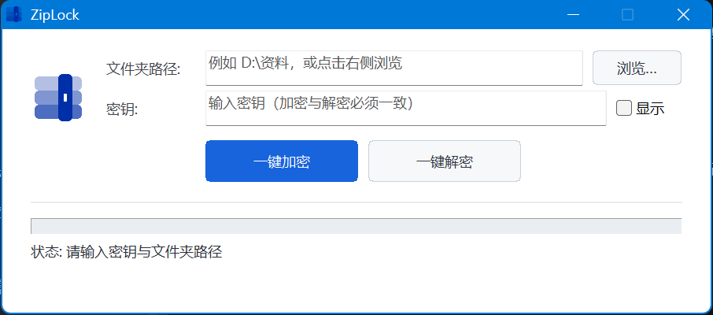

# ZipLock

一个 Windows 桌面小工具：把文件夹里的每个文件（含子文件夹）逐个加密成 `.7z`，也能一键还原。



## 功能特性

- **一键加密**：递归遍历输入文件夹，把每个文件压缩加密为 `原名.7z`，放在原位置（保持目录结构）；加密成功的原文件自动删除，失败/跳过的原文件一律保留
- **一键解密**：递归找到所有 `.7z` 解回原文件，解出成功后删除 `.7z`
- **密钥由使用者输入**：程序本身不保存任何密钥，加密与解密必须使用同一个密钥
- AES-256 加密 + 7z 文件名列表加密（无密码时连包内有哪些文件都看不到）
- 实时进度条、状态与统计提示；同名 `.7z` 已存在时跳过不覆盖
- 密钥错误时不会破坏任何文件：解密失败的原 `.7z` 完整保留
- 纯 Win32 API，单文件 exe，无运行时依赖

## 下载使用

从 [Releases](../../releases) 下载 `ZipLock.exe` 与 `7zr.exe`，放在同一文件夹，双击 `ZipLock.exe` 即可：

1. 输入（或浏览选择）要处理的文件夹路径
2. 输入双方约定的密钥（不能包含英文双引号 `"`）
3. 点 **一键加密**；收到文件的一方用同一密钥点 **一键解密**

> ⚠️ 密钥丢失无法恢复任何文件，请务必离线妥善保管。
> 程序内不含密钥，密钥请通过聊天软件之外的方式（口头/电话等）约定。

也提供命令行模式（适合脚本批处理）：

```
ZipLock.exe --cli encrypt <文件夹路径> <密钥>
ZipLock.exe --cli decrypt <文件夹路径> <密钥>
```

## 从源码构建

依赖：[MinGW-w64](https://winlibs.com/) GCC（开发环境为 GCC 16.2 UCRT，需支持 C++20）。

```
git clone https://github.com/GitHubOctopuses/ZipLock.git
cd ZipLock
build.bat
```

`build.bat` 默认使用 `D:\AZML\mingw64\bin` 的工具链，路径不同请自行修改开头两行。构建成功后生成 `ZipLock.exe`（静态链接，无 DLL 依赖）。

## 技术说明

- 压缩/加密引擎为 [LZMA SDK](https://www.7-zip.org/sdk.html) 自带的 `7zr.exe`（Igor Pavlov，public domain），由 ZipLock 通过无窗口子进程调用；仓库附带该文件以便 clone 后开箱即用
- 界面为纯 Win32 API：按钮为 owner-draw 自绘，进度条关闭主题后自定义配色
- 删除原文件前会校验 `.7z` 已生成且非空，7zr 退出码非 0 视为失败并保留原文件

## 许可

- 本项目代码以 [MIT License](LICENSE) 发布
- `7zr.exe` 来自 LZMA SDK，作者 Igor Pavlov，public domain
- 界面图标来自 [iconfont.cn](https://www.iconfont.cn/)（阿里巴巴矢量图标库）
